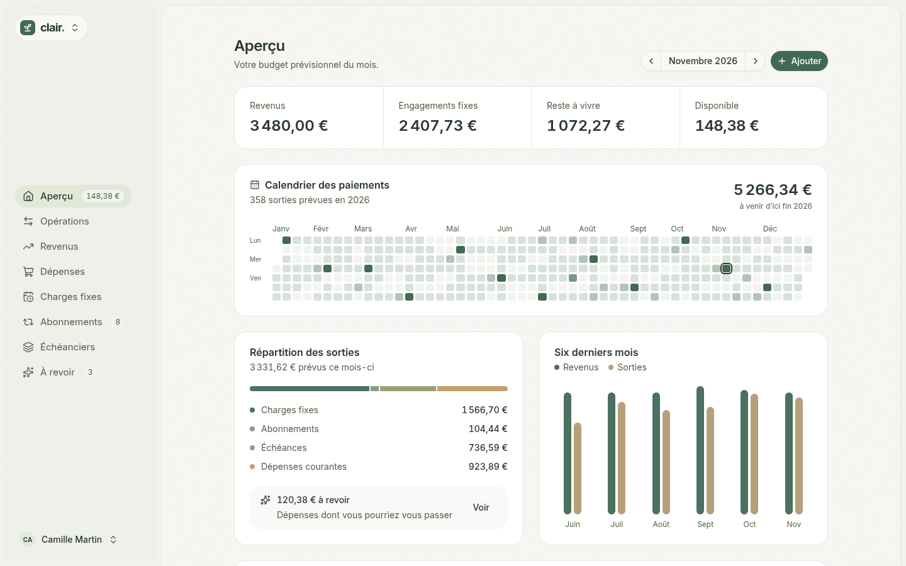
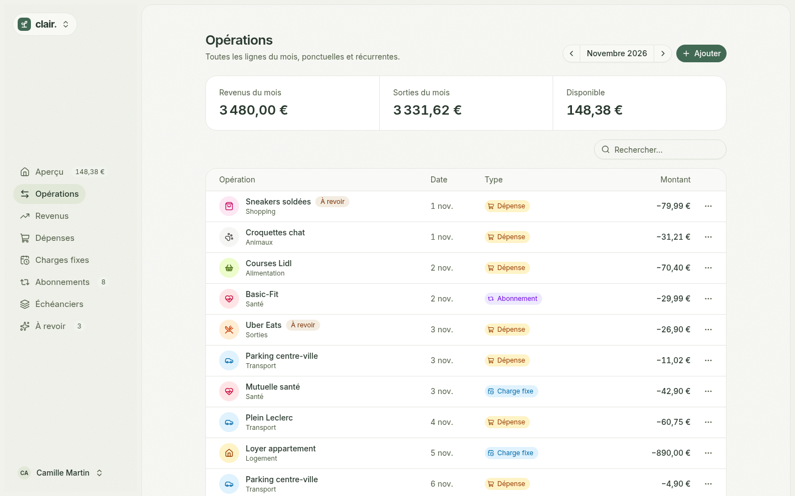
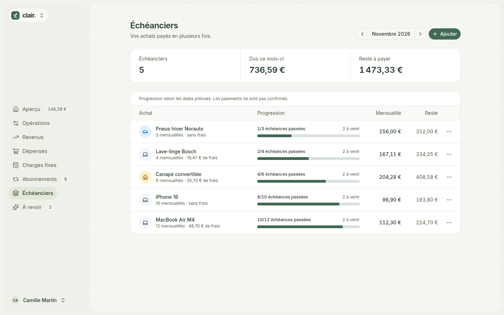

## Context

Most budgeting apps either want full access to your bank from day one or stay stuck at a spreadsheet. Clair starts with a plan you enter by hand, and the bank connection is optional. When it is on, real transactions confirm the plan instead of duplicating it.

## What's inside

- One-off, monthly and yearly income
- Everyday expenses by category, monthly envelopes for variable spending, and savings shown apart from expenses
- Fixed charges and subscriptions with an optional end date
- Installment purchases with fees spread across the schedule, the last payment adjusting the cents
- A monthly overview with a six-month history, upcoming payments and a yearly payment calendar
- Clear figures: what is left to live on after fixed commitments, and what is left to spend this month

## Bank sync and matching

An optional Enable Banking connection imports balances and transactions. Each transaction can be matched to a planned payment, including partial payments, refunds, splits, and date or amount gaps. Classification rules file similar transactions automatically, with a preview of the past transactions they would have matched. Clair never initiates a payment.

## Stack

AdonisJS 7, Inertia 3, Vue 3, Lucid and PostgreSQL, Tailwind CSS 4, shadcn-vue and Reka UI. Amounts are stored as integer cents. Oxlint, Oxfmt, unit, functional and Playwright browser tests run in CI.
