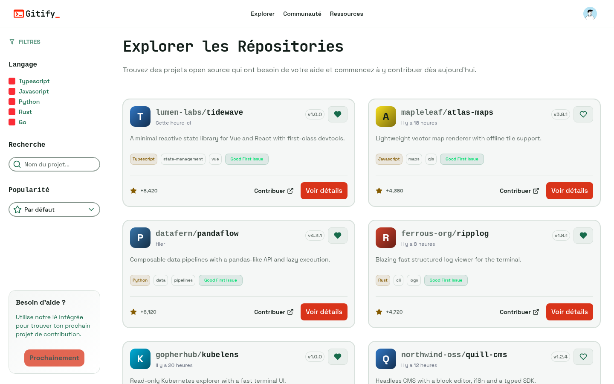
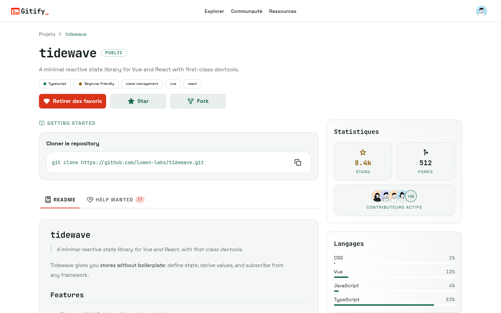

## The Idea

Finding a first open-source contribution is harder than it should be. GitHub search returns thousands of repositories with no sense of which ones welcome newcomers. Gitify narrows it down: pick a level and your languages, and get a feed of active projects that need help.

## What It Does

- **GitHub sign-in**: OAuth only, with the session kept in an HTTP-only cookie
- **Preferences**: beginner (projects with "good first issues") or expert (popular projects with "help wanted"), across 12 languages
- **Personalized feed**: up to 60 projects, spread evenly across the selected languages
- **Project pages**: README, language breakdown and contributors, fetched from GitHub on demand and cached for 7 days
- **Favorites**: save repositories to come back to them later

## Built With Aduxt

Gitify runs on the stack I packaged in Create Aduxt: AdonisJS 7 for the API, Nuxt 4 with Nuxt UI for the frontend, and Tuyau for type-safe calls between them. The monorepo uses pnpm workspaces and Turborepo, the API exposes an OpenAPI spec, and Docker Compose runs the whole dev environment.
