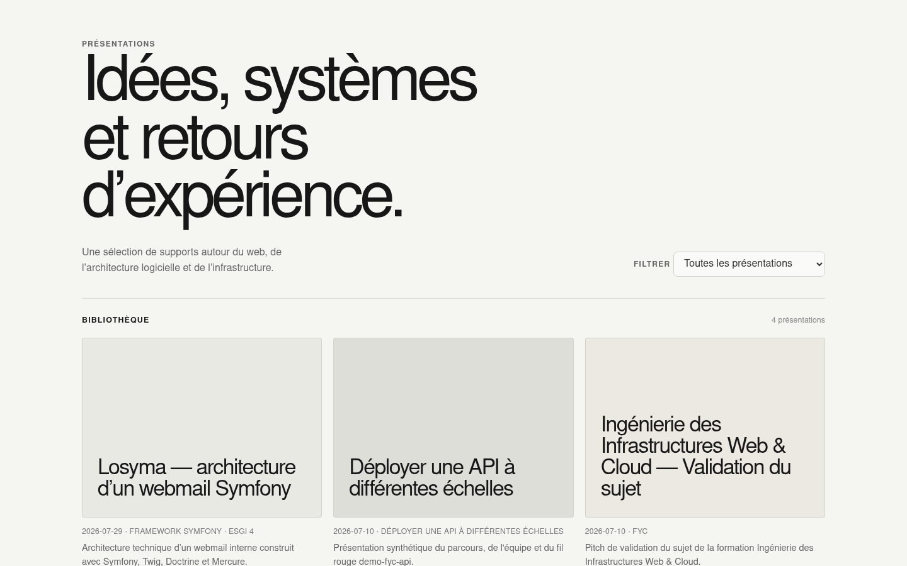
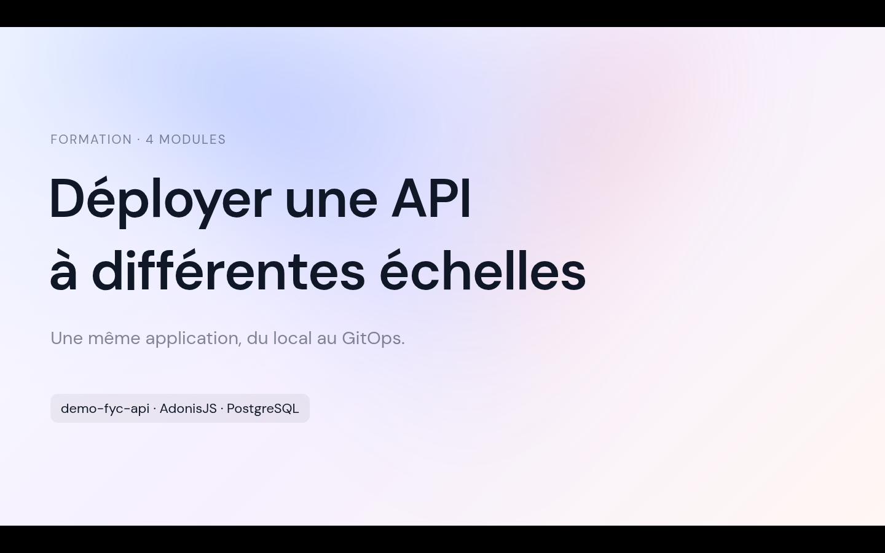

## Context

I give talks for school and for the courses I teach. Each one used to start from a copied folder with drifting styles. Talks puts every presentation in one repository, with a shared presentation system and a single workflow to author, run, export and publish.

## What's inside

- One folder per talk, with its own slides, components and media
- A shared identity: one idea per slide, progressive reveals, icon grids and serif section dividers
- Talk metadata (title, event, date, language, tags) in the slide frontmatter, used to build the catalog
- A CLI: `pnpm new`, `pnpm dev`, `pnpm build`, `pnpm export` and `pnpm publish`, plus validation of every talk
- A catalog page with filters, served with all built decks by a Cloudflare Worker

## Stack

Slidev, Vue, TypeScript, UnoCSS and a Cloudflare Worker serving static assets.
