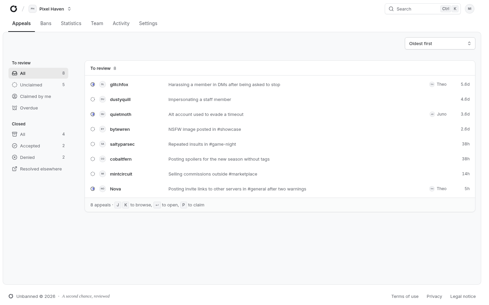
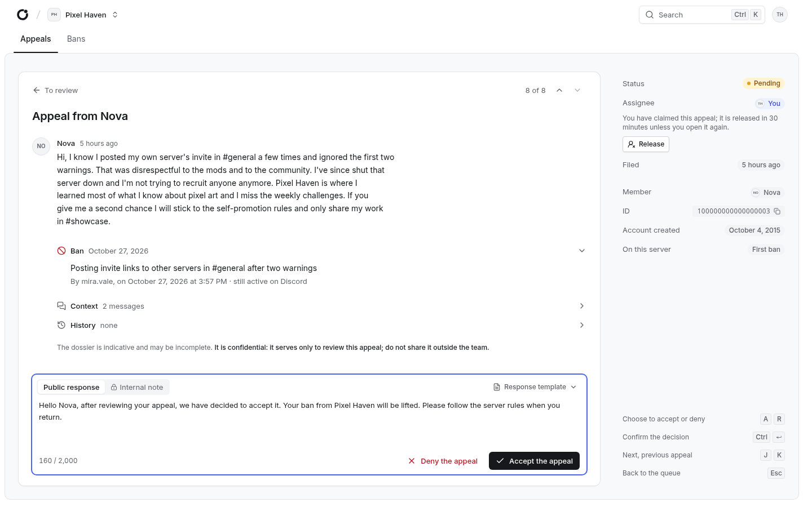
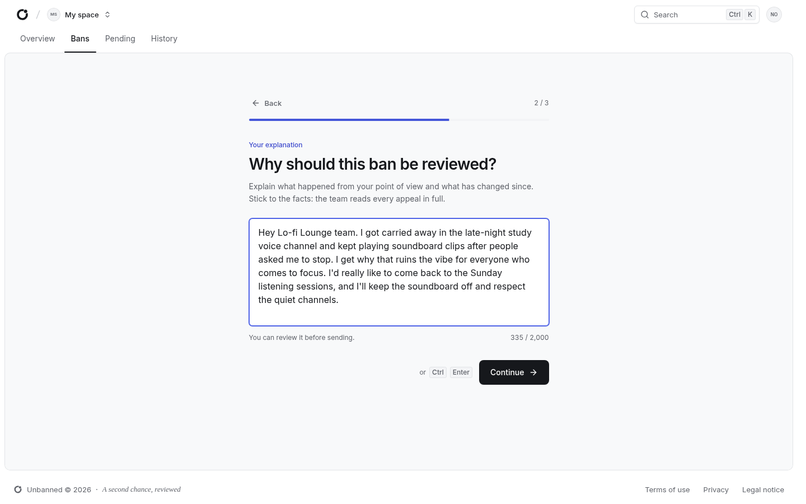

## Context

On Discord, a ban is usually final: the banned member has no way to ask for a second look, and moderators end up handling appeals in DMs or scattered forms. Unbanned gives each community a proper appeal process, connected to Discord itself.

## How it works

- A banned member signs in with Discord, reads the server's appeal instructions, and files an appeal
- Reviewers, chosen by Discord role, see pending appeals with the ban author and reason pulled from the audit log
- A reviewer claims an appeal so the team does not handle it twice; the claim expires after 30 minutes of inactivity
- Internal notes stay with the staff, while the decision always comes with a public response, optionally started from a response template
- An accepted appeal lifts the ban on Discord, and the bot notifies the member

## Built for real communities

Server managers configure everything from their Discord permissions: no separate accounts. Managers can suspend a reviewer's access without touching their Discord roles. Platform administrators monitor technical health without seeing private appeal content. Personal data processing, retention periods, backups and restore procedures are documented.

## Stack

AdonisJS, Inertia.js, Vue 3, TypeScript, Tailwind CSS 4 and PostgreSQL, with a background job worker and a Discord gateway process. Released as a Docker image, with unit, functional and browser tests in CI.
