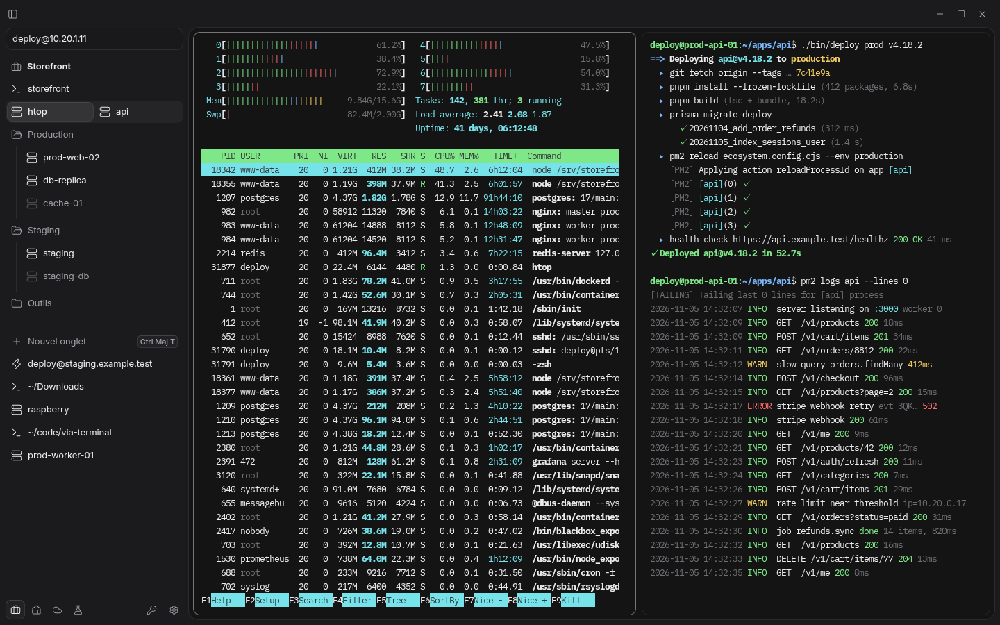
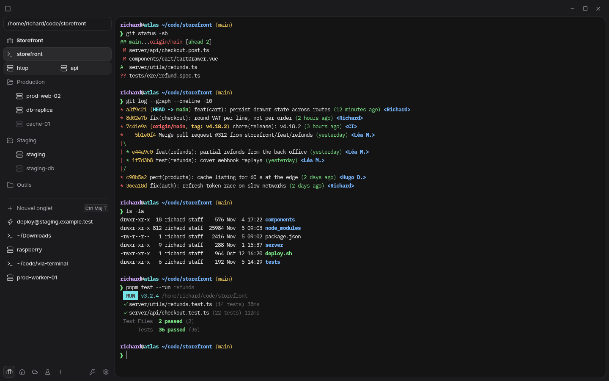
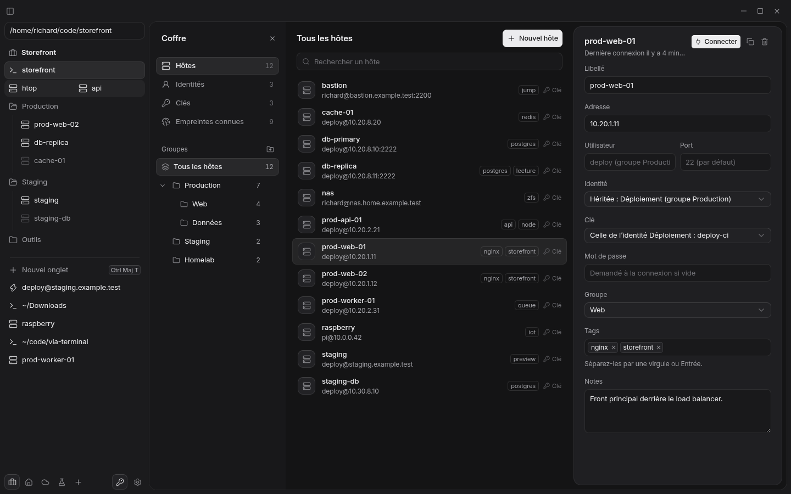

## Context

I spend my days jumping between local shells and remote servers. Most terminals treat SSH as an afterthought, and most SSH clients feel like admin panels. Via is a terminal you can live in: a sidebar of spaces and tabs for your sessions, a vault for your servers, and nothing in between.

## What's inside

- Local shells in a native PTY: PowerShell, CMD, WSL and Git Bash on Windows, and the installed shells on macOS and Linux
- An embedded SSH client that checks host keys in the interface, asks for 2FA codes, and reconnects in place
- A command bar to open a shell or a saved host, or connect straight to `user@host:port`
- Spaces, pinned tabs that come back asleep after a restart, and split views of up to four tabs
- A vault for hosts, identities, keys and known fingerprints, with secrets encrypted and the key held by the OS keychain
- A remote SFTP explorer, docked beside a terminal or in its own tab, with transfers and in-app editing
- Signed in-app updates, published as installers on GitHub Releases

## Local first

Via runs entirely on your machine: no account, no cloud, works offline. It never reads your `~/.ssh` directory. Product behavior, vocabulary and architecture decisions are documented in the repository as a spec, a glossary and ADRs.

## Stack

Tauri 2 and Rust for the native side (PTY, SSH, SFTP, keychain), Vue 3, TypeScript, Pinia, xterm.js with the WebGL renderer, CodeMirror and Tailwind CSS 4. CI runs formatting, linting, Vitest, `cargo test` and `clippy` on every pull request.
